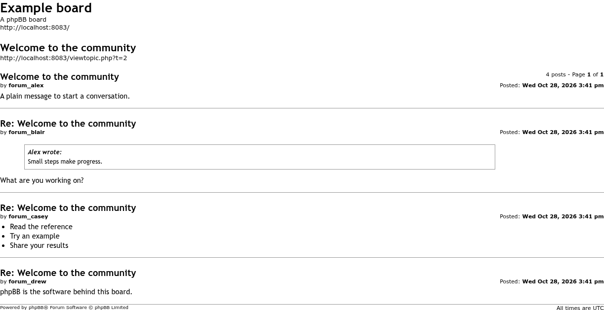

# Print All Posts

 

Lets users who can print topics in a forum print every post in a topic on one page.

## Features

- Adds a **Print all** link to the **Topic tools** menu, next to phpBB's own **Print view**. It opens in a new tab.
- phpBB's print view shows one page of posts at a time. **Print all** shows every post in the topic on a single printable page.
- Uses phpBB's existing **Can print topic** forum permission. Users without it don't see the link and can't open the page.

## Screenshots

<table>
  <tr>
    <td align="center"> Print all in the Topic tools menu</td>
    <td align="center"> Every post on one printable page</td>
  </tr>
</table>

Click a screenshot for the full size.

## Requirements

- phpBB 3.3.19 or later
- PHP 8.3.36 or later

## Installation

1. Copy the extension to `/ext/phpbbmodders/printallposts`
2. In the Administration Control Panel, go to **Customise → Manage extensions**
3. Enable the **Print all posts in a topic** extension

### Upgrading from `rmcgirr83/printallposts`

This extension used to be Rich McGirr's `rmcgirr83/printallposts`. To move to this version:

1. Disable the old **Print all posts in a topic** extension in the ACP. Do **not** delete its data.
2. Upload this version to `/ext/phpbbmodders/printallposts` and enable it. The new version won't enable while the old one is still on, and it removes the old extension's entry from the extension list when it is enabled.
3. Delete the `/ext/rmcgirr83/printallposts` folder and purge the board cache.

If you disable the old extension from the command line (`bin/phpbbcli.php`) instead of the ACP, run `bin/phpbbcli.php cache:purge` before enabling the new one; the command-line disable doesn't clear the cache.

## Contributing

Contributions are welcome!

- **Bug reports**: [Open an issue](https://github.com/phpbbmodders/printallposts/issues).
- **Everything else** (questions, feature requests, ideas, general discussion): [Use Discussions](https://github.com/orgs/phpbbmodders/discussions), or the [community forum](https://www.phpbbmodders.com/community/).
- Pull requests are welcome for bug fixes or discussed features.

## Acknowledgments

- Extension by Rich McGirr ([RMcGirr83](https://github.com/rmcgirr83)).
- Documentation assisted by [Claude](https://www.anthropic.com/claude).

## License

This extension is licensed under the **GNU General Public License v2.0**.

See [license.txt](license.txt) for more information.
